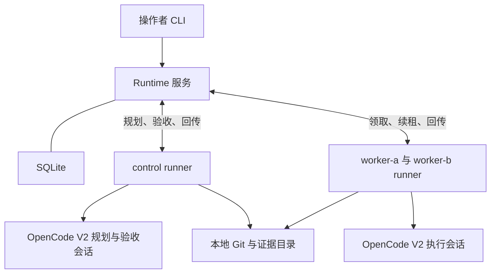

# Runtime 多 Agent 协作系统 · 完整项目规格

**版本：** v1.0 设计规格。**验证范围：** 一台机器，三个本地节点，全部 Agent 使用 OpenCode V2。本文给出产品行为、实现合同、部署步骤和交付验收。实现与实测状态见第 10 节。

## 1. 背景与愿景

现在，用户给 Agent 一个目标后，往往需要自己传递上下文、分配工作区、确认执行环境，再从聊天和日志里找证据。跨会话时，同一任务很容易丢失进度、重复执行，或者在尚未验收时被标为完成。机器之间能够通信，也仍然需要明确谁可以接活、哪个工作区是权威来源，以及如何将结果送回原委托会话。

Runtime 将这段协作变成一条可查询、可续接的工作流。**用户只需把目标交给一个固定规划会话，Runtime 保存拆解、派发、执行、验收和回传记录。** 规划会话继续理解用户意图。执行和验收使用独立工作区。用户可在同一入口看到谁在做、为什么等待、交付了什么，以及哪些证据足以确认完成。

首个用例是「修复测试失败，给出改动与验收结果」。这个用例故意使用小仓库，重点验证系统如何接力、处理进程故障和区分执行与验收。运行时间的指标只衡量本地系统的事件传播，不给模型生成时间设承诺。

## 2. 交付范围与用户流程

| 能力 | 本项目的交付 |
|---|---|
| 委托与拆解 | 固定 OpenCode V2 规划会话接收自然语言。提交一个或多个带依赖的任务提案，由中心校验后入库 |
| 执行与验收 | 两个本地 worker 竞争领取。控制节点使用另一 OpenCode V2 会话验收，并运行固定基线测试 |
| 消息与共享信息 | 按任务和目标会话投递、查收、回传。共享项目资料使用已登记的 Git 文件与版本 |
| 资源与派发 | 登记节点、在线状态、容量、能力、仓库映射及可用路线，按约束选择节点 |
| 可观测与接续 | CLI 查看状态和导出证据。中心与节点重启后可查询既有记录，执行结果不明确时进入待核对 |
| 权限与边界 | 操作者、控制节点、执行节点各自认证。记录凭据引用和允许主体，实际凭据留在本机节点配置 |

用户通过 CLI 提交目标，CLI 返回请求 ID。用户可立刻关闭终端，再用 ID 查询。控制节点把原话投递给固定规划会话。规划会话在自己的目录生成任务清单。中心验证清单、推进依赖并开放领取。执行节点按基线创建 checkout，驱动 OpenCode V2 修改并提交。验收方读取候选提交，在另一 checkout 检查差异和运行固定测试。结论写入任务时间线，并投递给原规划会话。查询时可分辨「已验收」和「规划会话已确认收到」。

**项目边界。** 交付物是一个本地验证版。跨机器网络建设、远程凭据代理、生产部署和 GUI 不属于本版交付。资源目录验证方向、作用域和新鲜度，SSH 类资源用本地测试记录验证建模与访问筛选。试验依赖可用的模型服务。

## 3. 架构与节点



| 进程 | 地址 | 身份与能力 |
|---|---|---|
| Runtime | `127.0.0.1:8080` | Rust 单服务，独占写入 SQLite，持有服务状态 |
| control | OpenCode `127.0.0.1:4096` | 控制 runner，固定规划会话与新建验收会话，能力 `review` |
| worker-a | OpenCode `127.0.0.1:4097` | 执行 runner，能力 `fixture-exec`，执行槽 1 |
| worker-b | OpenCode `127.0.0.1:4098` | 执行 runner，能力 `fixture-exec` 和 `fixture-special`，执行槽 1 |

每个节点有独立 runner、OpenCode 服务、认证身份、OpenCode 数据目录、runner 日志与恢复目录，以及 checkout 根目录。同一节点允许多个会话，单次 run 使用自己的 checkout 和会话引用。控制节点的规划会话固定，验收单独创建会话。不同角色共享项目引用，分别拥有自己的会话历史。所有进程以 loopback 通信，模型访问依其 provider 配置。

节点分离验证的是应用身份、会话存储和进程故障边界。同一系统用户仍有操作系统授予的文件访问权限。本地共享 bare Git 仅用于已登记测试仓库。runner 从固定基线创建 checkout，完成后发布唯一 run ref，验收端通过 SHA 读取。Runtime 保存证据索引和相对路径，证据文件存到本地目录，落盘后由中心核对哈希并入库。

## 4. 模块与仓库结构

| 模块 | 实现职责 |
|---|---|
| `domain` | ID、角色、计划校验、状态转换、调度与授权规则 |
| `store` | SQLite 迁移、事务、查询、事件与幂等约束 |
| `service` | HTTP、鉴权、恢复巡检、证据索引与状态查询 |
| `runner` | 节点注册、领取和续租、OpenCode V2 驱动、工作区和本地日志 |
| `opencode_v2` | 封装原生协议、消息去重和会话恢复 |
| `cli` | 配置检查、提交、状态与事件查询、证据导出、人工处置 |
| `tests/fixtures` | Git 试件、固定验收脚本、测试暂停点和端到端用例 |

建议在一个 Rust workspace 实现，提供单个 `runtime` 可执行文件，以子命令区分服务与 runner。服务进程拥有数据库，runner 通过 API 更新。OpenCode 的会话存储由其本身负责。CLI 使用公开 API，验收脚本可读取命令输出和导出的证据。

## 5. 数据、状态与一致性

| 数据 | 字段及约束 |
|---|---|
| Request | `request_id`、原始意图、仓库与基线、规划会话绑定、操作方、计划版本、状态 |
| Task | `task_id`、请求 ID、目标、交付物、验收配置、能力约束、可选固定节点、必需路线、依赖和状态 |
| Run | `run_id`、任务 ID、类型 `execute/review`、尝试序号、节点 ID、会话 ID、租约代次与到期时间、候选 SHA |
| Node | `node_id`、角色、能力、容量、最后心跳、仓库映射。身份从认证映射，角色和能力受中心配置限制 |
| Message | `message_id`、发送主体、目标节点与会话、关联任务或请求、类型、投递和确认时间 |
| Evidence | `run_id`、类型、相对路径、SHA-256、来源。Git 证据同时记录基线、候选 SHA 和 run ref |
| Review | 验收 run、被验收的执行 run、候选 SHA、固定检查退出码、Agent 结论、最终判定 |
| Resource | 稳定资源 ID、类型、节点归属、版本、可见范围、证据或观测时间、有效期、可选凭据引用 |
| Event | 单调递增序号、实体 ID、事件类型、认证主体、时间和精简载荷 |

SQLite 开启外键。对请求和消息保存主体范围内的幂等键及正文摘要，同键同正文返回已有记录，同键不同正文拒绝。每个任务最多有一个同类非终态 run。每次状态变化和事件在同一事务提交。状态页以中心为准，模型回复作为证据或上下文保存。

| 实体 | 状态和推进规则 |
|---|---|
| Request | `planning → active → accepted/rejected`。规划失败进入 `blocked`，保留原因。所有必需任务通过才可标为 accepted |
| Task | `waiting_dependency → queued → running → awaiting_review → accepted/rejected`。失败、取消及待核对保留明确原因。失败依赖令下游继续阻塞 |
| Run | `leased → session_bound → prompt_admitted → running → finished`，另有 `failed`、`uncertain`、`canceled`。观察到工具活动或模型运行才标 running。短 run 允许凭完成证据直接结束 |
| Message | `queued → admitted → delivered → acknowledged`。admitted 来自 V2 接收响应，delivered 来自指定会话的消息查询，acknowledged 来自该会话对结果 ID 的确认 |

任务待领取但没有合格节点时，状态保留 `queued`，原因显示 `no_matching_online_node`。若已有 run 的执行状态不明，禁止创建替代 run，直到完成核对或操作者明确关闭旧尝试。

### 5.1 调度、租约与恢复

- runner 每 2 秒轮询，每 5 秒心跳。中心以自身时钟判断最后心跳超过 15 秒为离线。领取事务检查节点在线、角色、仓库映射、剩余执行槽、全部能力、未过期的必需路线和已通过的依赖。多个符合条件的节点用先领取成功的事务确定归属。
- run 租约 30 秒，由 runner 每 5 秒续租。写入事件要匹配节点身份和租约代次。过期持有者回写返回冲突。只有中心能为同一 run 向同一节点发放新的恢复租约。
- 调用 OpenCode 之前，runner 先持久化 run、目标会话、稳定消息 ID、精确请求正文和阶段。进程重启后先查询中心和会话。消息已进入会话时复用原会话，待投递时按同 ID 重试。无法确认时进入 `uncertain`，CLI 列出原因和最近证据。
- 规划回传采用同一机制。消息的幂等键由验收 run 和目标会话决定。用户查询任务时，交付判定与回传状态独立显示。计划、验收或回传失败均有超时与错误原因。
- 发布本地候选 ref 时禁止覆盖不同 SHA。中心验证候选来自指定基线，验收阶段使用绑定的候选 SHA，拒绝其他 run 或旧尝试的验收报告。

## 6. 共享信息、会话权限与资源目录

| 记录 | 示例 | 规则 |
|---|---|---|
| 共享知识 | `fixture@<base_sha>:README.md` | 用 Git 路径及提交固定版本。节点可按任务授权读取 |
| 仓库映射 | `fixture → /.../fixture.git` | 中心登记逻辑 ID，runner 按本地映射解析，模型无法指定任意绝对路径 |
| 节点能力 | `worker-b: fixture-special` | 中心允许后才纳入调度。离线节点的能力保留可查，停止参与派发 |
| 有方向的路线 | `worker-a → lab-service` | 记录来源节点、目标资源、连接方式、观测时间、有效期。只返回适用路线。过期路线标为待核对 |
| 凭据引用 | `local:worker-a/lab-service` | 中心保存用途、允许主体与引用。具体值由节点提供，验收使用合成标记检查日志和导出 |

操作者可以创建目标、查询证据与处理待核对。control 可以写计划、验收及确认回传。worker 只能领取允许的执行任务、更新属于自己的 run、读取允许的资源。不同角色的权限由中心强制检查。OpenCode 会话只能通过适配器参与工作，适配器对提案和报告做结构校验。节点令牌及服务密码置于各自进程配置，交付产物和事件中只出现引用。

## 7. 接口合同与角色交接

### 7.1 Runtime API

| HTTP 接口 | 输入与结果 |
|---|---|
| `POST /v1/requests` | 原始意图、`repo_ref`、`baseline_sha`、`required_capabilities` 与可选的 `required_routes`。事务写入请求及发往 control 的规划消息，返回请求 ID 和规划状态 |
| `PUT /v1/requests/{id}/plan` | control 提交完整计划，事务验证 ID、唯一任务键、无环依赖、仓库与允许的验收配置。请求指定的能力与必需路线必须保留 |
| `GET /v1/requests/{id}`、`GET /v1/tasks/{id}` | 请求或任务及相关状态、run、证据索引、回传状态 |
| `GET /v1/requests/{id}/events?after=N` | 依事件序号补读，返回事件和下一游标 |
| `PUT /v1/planner/binding` | control 注册固定会话 ID。重复登记同一绑定成功，更换现有绑定需要操作者处置 |
| `POST /v1/nodes/heartbeat` | 节点声明健康和容量，中心根据认证识别节点，并限制其能力范围 |
| `POST /v1/runs/claim` | 按角色领取执行或验收工作，返回任务、run、租约代次及到期时间。无任务返回 204 |
| `POST /v1/runs/{id}/renew`、`POST /v1/runs/{id}/events` | 带租约代次续租或追加运行事件。结论与证据校验通过后推进状态 |
| `POST /v1/tasks/{id}/retry` | 操作者在旧 run 已结束或关闭后，将任务重新开放领取 |
| `POST /v1/runs/{id}/recover`、`POST /v1/runs/{id}/resolve` | 原节点申请核对同一个 run，操作者按证据关闭或解除待核对。人工操作写入审计 |
| `POST /v1/messages`、`GET /v1/inbox`、`POST /v1/messages/{id}/ack` | 持久投递、按游标查收、推进经证据确认的投递状态 |
| `GET /v1/resources` | 根据认证主体筛选项目、节点和路线，带来源、观测时间及有效期 |
| `PUT /v1/resources/{id}/observation` | 授权节点更新属于自己的路线观测。中心使用接收时间计有效期 |
| `GET /v1/runs/{id}/evidence/{name}` | 下载有权限的已登记证据文件，中心校验规范路径和哈希 |

认证失败返回 401，权限不足返回 403，未知对象返回 404，租约或幂等冲突返回 409，结构或状态非法返回 422。错误正文为 `{code,message,request_id}`。写入接口接受 `Idempotency-Key`，测试日志保存请求 ID 和状态码。

### 7.2 Agent 输入与输出

规划会话接收原话、仓库引用、基线、能力标签、可选必需路线和允许的验收配置。它在自己的工作目录写出 `plans/<request_id>.json`，先写临时文件，再原子重命名。适配器等待对应模型输出或规划文件完成标记后，按请求 ID 读取并校验。示例：

```json
{
  "request_id": "req-fixture-01",
  "tasks": [
    {
      "key": "fix-counter",
      "objective": "修复计数器返回值",
      "deliverable": "一个仅修改 counter.py 的 Git 提交",
      "repo_ref": "fixture",
      "required_capabilities": ["fixture-exec"],
      "acceptance_profile": "counter-v1",
      "depends_on": []
    }
  ]
}
```

执行会话接收任务内容、基线、工作目录和交付要求。runner 依据任务分配本地 Git 提交，导出补丁、测试日志和哈希。验收会话拿到原始要求、候选 SHA、差异和固定检查结果，写出以下报告。测试命令和允许的变更范围由 `counter-v1` 固定，候选中的测试脚本不可替换验收标准。

```json
{
  "run_id": "run-review-01",
  "candidate_sha": "实际候选 Git SHA",
  "verdict": "pass",
  "reason": "固定测试通过，差异只涉及 counter.py"
}
```

中心核对报告所属 run、候选 SHA、独立验收角色、实际退出码和证据。返回给规划会话的消息包含 `request_id`、任务结论、证据引用和稳定结果 ID。规划会话被要求回显结果 ID。回显只确认收到了该结果。

## 8. CLI、配置与部署

| 命令 | 行为 |
|---|---|
| `runtime serve --config central.toml` | 校验配置、迁移数据库、启动中心 |
| `runtime runner --config control.toml` | 注册控制节点，建立或恢复固定规划会话，处理验收和回传 |
| `runtime runner --config worker-a.toml` | 启动本地节点 A，连接 4097 |
| `runtime runner --config worker-b.toml` | 启动本地节点 B，连接 4098 |
| `runtime submit --repo fixture --baseline <SHA> --require fixture-exec "<目标>"` | 投递原始目标，输出请求 ID，可重复指定能力。V08 另支持 `--require-route <resource_id>` |
| `runtime status --request <ID> --json` | 返回目标、任务、候选和独立验收及回传状态 |
| `runtime events --request <ID> --after 0` | 读取有序事件 |
| `runtime evidence --run <ID> --out ./evidence` | 导出记录、补丁、日志、报告和哈希 |
| `runtime resolve --run <ID> --decision <关闭旧尝试或继续核对> --reason "<依据>"` | 有权限时记录处置。决定关闭后允许通过 `runtime retry --task <ID>` 创建新 run |

配置以绝对路径为准。操作者 CLI 从 `RUNTIME_URL` 和 `RUNTIME_OPERATOR_TOKEN` 读取连接信息，默认地址为 `http://127.0.0.1:8080`。下面是两种最小配置的合同示例，启动前替换路径，并为各进程设置其引用的环境变量。control 和 worker-b 使用同一 runner 格式，按第 3 节设置 ID、端口、角色和各自路径。control runner 初始化后将规划会话映射落盘并提交中心。启动时找回同一映射，若已有绑定但 OpenCode 找不到会话，中心标记阻塞，用户可查原因。

```toml
# central.toml
listen = "127.0.0.1:8080"
database = "/absolute/path/runtime-v2-lab/central/runtime.sqlite"
evidence_root = "/absolute/path/runtime-v2-lab/central/evidence"
operator_token_env = "RUNTIME_OPERATOR_TOKEN"
planner_node = "control"
offline_after_seconds = 15
lease_seconds = 30

[nodes.control]
role = "control"
capabilities = ["review"]
token_env = "RUNTIME_CONTROL_TOKEN"

[nodes.worker-a]
role = "worker"
capabilities = ["fixture-exec"]
token_env = "RUNTIME_WORKER_A_TOKEN"

[nodes.worker-b]
role = "worker"
capabilities = ["fixture-exec", "fixture-special"]
token_env = "RUNTIME_WORKER_B_TOKEN"

[repositories.fixture]
bare_path = "/absolute/path/fixture.git"
acceptance_profiles = ["counter-v1"]
```

```toml
# worker-a.toml
node_id = "worker-a"
role = "worker"
capabilities = ["fixture-exec"]
capacity = 1
runtime_url = "http://127.0.0.1:8080"
runtime_token_env = "RUNTIME_WORKER_A_TOKEN"
opencode_url = "http://127.0.0.1:4097"
opencode_password_env = "OC_WORKER_A_PASSWORD"
runner_dir = "/absolute/path/runtime-v2-lab/worker-a/runner"
work_root = "/absolute/path/runtime-v2-lab/worker-a/work"
poll_seconds = 2
heartbeat_seconds = 5

[repositories]
fixture = "/absolute/path/fixture.git"
```

启动顺序为附录 A 的 OpenCode 实例、Runtime、control 和 worker-a。配置中的 OpenCode 密码必须与对应启动脚本输入一致。先提交一条普通任务，再启动 worker-b 验证并发领取及能力匹配。CLI 显示最近心跳和可解释的等待原因。清理前暂停领取并确认在途 run 的处置结果。使用 SQLite 备份机制保存数据库，同时保留 Git run refs、证据目录、runner 日志与 OpenCode 节点数据。恢复时先启动查询，核对待处理 run 和回传队列，再恢复领取。

## 9. 开发顺序与验收

| 阶段 | 交付 | 退出条件 |
|---|---|---|
| M0 验证上游 | 启动与探针脚本，三份会话 API 证据 | V01 通过后实现适配器 |
| M1 委托闭环 | 中心、基础 CLI、control、worker-a、本地 Git 交接和独立验收 | V02、V03 通过 |
| M2 本地多节点 | worker-b、按能力调度、租约恢复、消息去重 | V04–V07 通过 |
| M3 交付与运维 | 资源目录、完整证据导出、备份恢复和本地运行说明 | V08–V10 通过，全量复跑通过 |

| 编号 | 可复跑操作 | 通过判据 |
|---|---|---|
| V01 | 对三个本地服务执行附录 A。分别续接原会话，并向另一个节点查询该会话 | 三个服务 PID 不同。原会话可读取历史且相同输入只出现一次。异节点会话返回 404 |
| V02 | 用附录 B fixture 和 control、worker-a 提交修复目标 | 从 CLI 查到规划、执行、验收三个独立会话。提交及日志可核验，结果 ID 返回原规划会话 |
| V03 | 让验收输入分别使用基线提交、篡改测试的提交和真实修复提交 | 前两者被固定检查驳回。仅真实修复可通过。执行方的自报成功不能推进验收 |
| V04 | 让两个 worker 同时领取同一个仅要求 `fixture-exec` 的任务，再以无效租约回写 | 只有一个活跃执行 run。失效租约回写返回 409，证据只有一个归属 |
| V05 | 用测试暂停点停在 V2 接收 prompt、中心尚未记入事件的位置。终止 runner，保持 V2 服务运行，按原身份重启 | 同一个 run、会话和消息 ID 恢复。会话里只有一条对应输入。模拟无法核对时，任务停在待核对 |
| V06 | 使 control 的投递循环暂停，重复提交同一验收结果，再恢复投递。另用 worker 读取或确认 control 的消息 | 只有一条逻辑消息，恢复后进入原会话，越权读取或确认被拒绝 |
| V07 | 提交仅 worker-b 满足的 `fixture-special` 任务，完成后停掉 B，等待心跳过期，再提交同类任务并恢复 B | 两次执行均在 B，等待期无其他节点启动。恢复后有验收和原会话确认记录 |
| V08 | 给 A、B 配置指向同一资源的不同路线，令 A 的观测到期。读资源并提交要求已验证路线的任务 | 节点只能查到自己有权使用的路线。A 的路线过期后被排除。导出不包含合成凭据值 |
| V09 | 用两条任务并发写同名文件，在各自 checkout 提交和验收 | 两条 run 的会话、目录、commit 与证据独立。每份报告只引用绑定候选 |
| V10 | 在已领取和待回传时分别做受控备份并重启中心，恢复数据库与相关文件 | 原 ID、事件游标和证据哈希仍可核对。待回传能继续。既有运行不会因恢复而直接重派 |

V04 使用测试屏障在领取前同步两个 worker，V05 的测试暂停点必须由可控测试配置开启。V08 可通过测试 fixture 注入观测时间，V10 在重新开放领取前执行状态核对。每次复跑记录 OpenCode 版本或源码提交、节点 PID、请求和任务 ID、会话与消息 ID、候选 SHA、退出码及最终判定。健康状态下，事件成功写入后 10 秒内应可查询。没有真实模型和运行记录的用例只能标记待执行或阻塞。

## 10. 交付物与当前验证状态

交付时仓库应包含 Runtime 源码和数据库迁移、三个节点的配置样例、启动和验收脚本、固定试件生成脚本、验收记录与操作说明。实现者按 M0–M3 顺序提交，并为各阶段保留可重跑命令及证据。本文为设计与验收规格。已检查 Bash、JSON 和 TOML 示例，使用替身命令核对三个节点的启动参数，并实跑 Git 基线失败、候选提交交接及独立固定测试通过。真实模型调用及 Runtime 端到端验收待执行。

## 附录 A · OpenCode V2 启动与接入探针

以下命令针对 `anomalyco/opencode` 的原生 V2 协议。已核对源码提交 `ee368d2ab04b89f0eeb691a0e69c9a195893aa19`，仓库版本字段为 `2.2.5`。已有 V2 二进制可直接试跑，验收时记录实际版本和二进制 SHA-256。按源码构建的 CLI 可能显示 `local`，此时同时记录源码 SHA。以成功通过下方原生 API 检查作为接入门槛。

准备 Linux、Bash、Git、curl、jq、Python 3，以及已经登录并可实际发起模型调用的 OpenCode V2。需要从源码准备时，安装该提交指定的 Bun `1.4.4` 后执行以下命令。在后续命令里将 `opencode` 换成该源码入口。

```bash
git clone https://github.com/anomalyco/opencode.git opencode-v2-src
cd opencode-v2-src
git checkout --detach ee368d2ab04b89f0eeb691a0e69c9a195893aa19
bun install --frozen-lockfile
bun run dev --version
# 后续 opencode serve 对应在此仓库中运行 bun run dev serve
```

在同一台机器准备节点启动脚本。将其保存为 `start-oc.sh`。使用源码入口时，将最后一行替换为 `cd /绝对路径/opencode-v2-src && exec bun run dev serve --hostname 127.0.0.1 --port "$port"`。

```bash
#!/usr/bin/env bash
set -euo pipefail
case "${1:-}" in
  control)  node=control; port=4096 ;;
  worker-a) node=worker-a; port=4097 ;;
  worker-b) node=worker-b; port=4098 ;;
  *) echo 'Usage: bash start-oc.sh control|worker-a|worker-b' >&2; exit 2 ;;
esac
root="$HOME/runtime-v2-lab/$node"
umask 077
mkdir -p "$root"/{data,state,cache,config,runner,work}
export XDG_DATA_HOME="$root/data"
export XDG_STATE_HOME="$root/state"
export XDG_CACHE_HOME="$root/cache"
export XDG_CONFIG_HOME="$root/config"
export OPENCODE_CONFIG_DIR="$root/config/opencode"
unset OPENCODE_SERVER_PASSWORD
read -rsp "OpenCode V2 password for $node: " OPENCODE_PASSWORD
printf '\n'
test -n "$OPENCODE_PASSWORD"
export OPENCODE_PASSWORD
exec opencode serve --hostname 127.0.0.1 --port "$port"
```

分别在终端运行 `bash start-oc.sh control`、`bash start-oc.sh worker-a` 和 `bash start-oc.sh worker-b`。为三个节点设置各自的测试服务密码。模型认证也要在各节点的环境中准备，可以使用同一个已授权的测试模型账号。若使用本机登录配置，先在对应 XDG 和配置目录下登录。服务重启时复用原目录和节点身份。

在终端 B 运行以下探针。它确认服务协议、工作目录、真实模型响应、同一会话上下文，以及重复消息 ID 在会话中的去重。保留返回的 JSON 和工作目录供复查。

```bash
set -euo pipefail
read -rsp 'OpenCode V2 测试服务密码: ' OC_PASS; printf '\n'
test -n "$OC_PASS"
OC=${OC_URL:-http://127.0.0.1:4096}
OUT=$(mktemp -d)
OUT=$(cd "$OUT" && pwd -P)
mkdir "$OUT/probe"
api() { curl -fsS --max-time 180 -u "opencode:$OC_PASS" "$@"; }
post() { api -H 'Content-Type: application/json' -X POST "$1" --data "$2"; }

api "$OC/api/info" | tee "$OUT/info.json" | jq -e '.version | type == "string"' >/dev/null
post "$OC/api/session" "$(jq -nc --arg d "$OUT/probe" \
  '{title:"Runtime V2 probe",location:{directory:$d}}')" > "$OUT/session.json"
sid=$(jq -er '.data.id' "$OUT/session.json")
jq -e --arg d "$OUT/probe" '.data.location.directory == $d' "$OUT/session.json" >/dev/null

nonce=$(python3 -c 'import secrets; print(secrets.token_hex(8))')
id1="msg_$(python3 -c 'import uuid; print(uuid.uuid4().hex)')"
id2="msg_$(python3 -c 'import uuid; print(uuid.uuid4().hex)')"
p1=$(jq -nc --arg id "$id1" --arg n "$nonce" \
  '{id:$id,text:("记住此代号 "+$n+"。只回复 FIRST-ACK"),delivery:"queue",resume:true}')
p2=$(jq -nc --arg id "$id2" \
  '{id:$id,text:"只回复 SECOND- 加上第一条消息中的代号。",delivery:"queue",resume:true}')

post "$OC/api/session/$sid/prompt" "$p1" > "$OUT/admitted-1.json"
post "$OC/api/experimental/session/$sid/wait" '{}' >/dev/null
post "$OC/api/session/$sid/prompt" "$p2" > "$OUT/admitted-2.json"
post "$OC/api/experimental/session/$sid/wait" '{}' >/dev/null
post "$OC/api/session/$sid/prompt" "$p2" > "$OUT/replay-2.json"

# 等待第二条回复写入，兼容 wait 在调度启动前返回的情况。
for _ in $(seq 1 60); do
  api "$OC/api/session/$sid/message?limit=100" > "$OUT/history.json"
  if jq -e --arg expected "SECOND-$nonce" \
      '[.data[] | select(.type == "assistant") | .. | strings | select(. == $expected)] | length == 1' "$OUT/history.json" >/dev/null; then
    break
  fi
  sleep 1
done

api "$OC/api/session/$sid/message/$id2" > "$OUT/user-message-2.json"
jq -e --arg expected "SECOND-$nonce" \
  '[.data[] | select(.type == "assistant") | .. | strings | select(. == $expected)] | length == 1' "$OUT/history.json" >/dev/null
jq -e --arg id "$id2" '[.data[] | select(.id == $id)] | length == 1' \
  "$OUT/history.json" >/dev/null
api "$OC/api/session/$sid/inbox" > "$OUT/inbox.json"
jq -e '.data | length == 0' "$OUT/inbox.json" >/dev/null
printf 'V2 probe passed, session=%s, evidence=%s\n' "$sid" "$OUT"
```

对三个端口分别运行同一探针，执行前设置 `OC_URL=http://127.0.0.1:4096`、`4097` 或 `4098` 对应的完整 URL，并输入该节点的密码。保存三份 `info.json`，确认 PID 各不相同。用 worker-a 的正确认证向 worker-a 查询 control 的探针会话，`GET /api/session/<control-session-id>` 应返回 404，再反向验证一次。这一步核对会话存储确实隔离。探针失败时记录失败请求和状态。先检查接口版本、鉴权和 provider 日志，再复跑。HTTP 200 只代表对应请求成功。Prompt 的接收、消息进入上下文、模型产生结果分别检查。附录 A 的通过记录作为 M0 交付证据。

## 附录 B · 生成测试仓库并复跑固定验收

以下测试仓库可直接创建。它只有标准库依赖，且初始测试稳定失败。保留输出的基线 SHA 和 bare 仓库路径，填入 Runtime 及三个 runner 的测试配置。

```bash
set -euo pipefail
FIXTURE=$(mktemp -d)
cd "$FIXTURE"
git init -q
git config user.name 'Runtime Fixture'
git config user.email 'runtime-fixture@example.invalid'
cat > counter.py <<'PY'
def increment(value):
    return value
PY
cat > test_counter.py <<'PY'
import unittest
from counter import increment

class CounterTest(unittest.TestCase):
    def test_increment(self):
        for value in (-1, 0, 5):
            self.assertEqual(increment(value), value + 1)
PY
git add counter.py test_counter.py
git commit -qm 'Seed failing increment fixture'
if PYTHONDONTWRITEBYTECODE=1 python3 -m unittest -v test_counter; then
  echo 'Invalid fixture: expected failure' >&2
  exit 1
fi
git clone -q --bare "$FIXTURE" "$FIXTURE.git"
printf 'fixture=%s bare=%s baseline=%s\n' "$FIXTURE" "$FIXTURE.git" "$(git rev-parse HEAD)"
```

验收时从基线提交提取 `test_counter.py`，在独立目录放入候选提交中的 `counter.py`，执行 `PYTHONDONTWRITEBYTECODE=1 python3 -m unittest -v test_counter`。用 `git merge-base --is-ancestor BASE CANDIDATE` 确认继承关系，再用 `git diff --name-only BASE CANDIDATE` 确认唯一变更为 `counter.py`。测试和差异检查均通过后，才允许独立验收会话给出通过结论。

上游依据：[固定版本的 V2 会话协议](https://github.com/anomalyco/opencode/blob/ee368d2ab04b89f0eeb691a0e69c9a195893aa19/packages/protocol/src/groups/session.ts) · [会话与幂等语义](https://github.com/anomalyco/opencode/blob/ee368d2ab04b89f0eeb691a0e69c9a195893aa19/specs/v2/session.md) · [V2 服务启动](https://github.com/anomalyco/opencode/blob/ee368d2ab04b89f0eeb691a0e69c9a195893aa19/packages/cli/src/server-process.ts)
